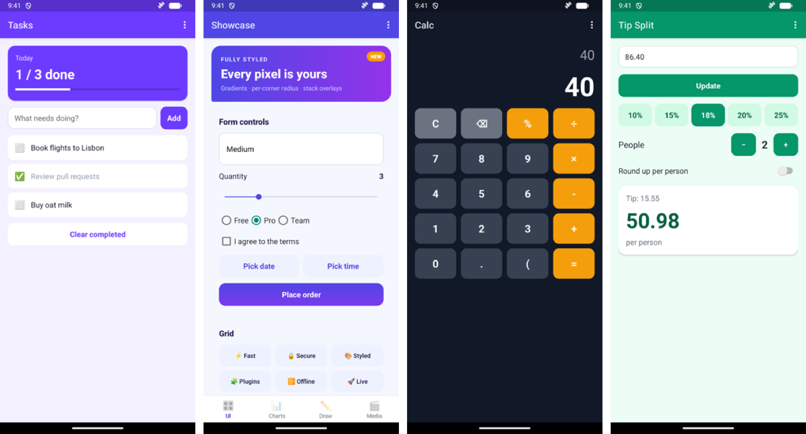
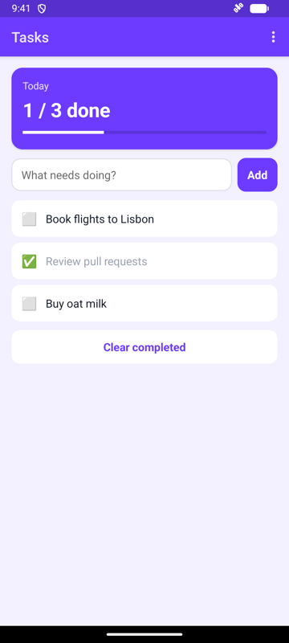
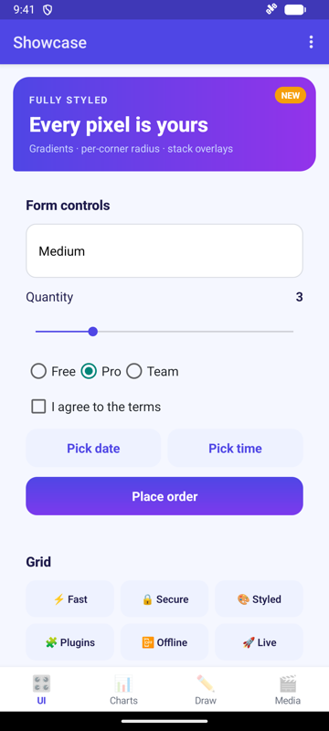
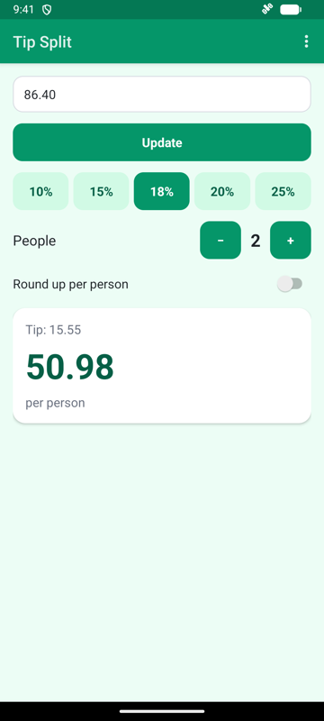
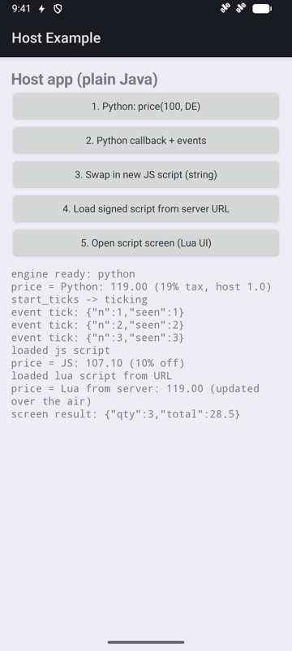
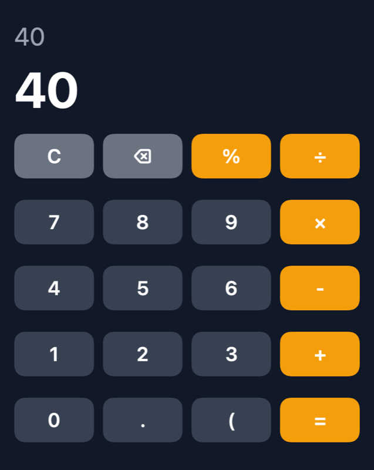
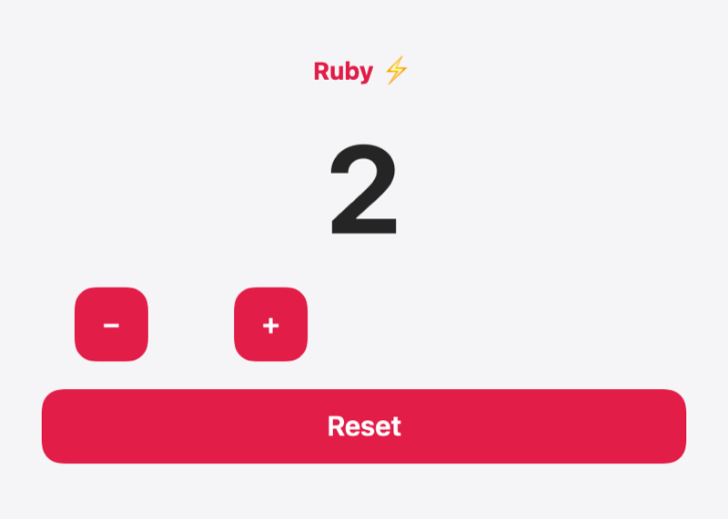

<div align="center">

# 🦎 Polymorph

### Write real mobile apps in **Python, JavaScript, Lua, Ruby or PHP**.<br>Fix them live, without waiting for an app store.

[](#-platforms-and-languages)
[](#-platforms-and-languages)
[](#-platforms-and-languages)
<br>
[](#)
[](#)
[](#)
[](#)
[](#)
[](LICENSE)




<sub>Four real apps, each written in a different language and running fully offline on Android: a Lua to-do list, a JavaScript showcase, a JavaScript calculator and a PHP tip splitter.</sub>

</div>

---

## ✨ What is Polymorph?

I built Polymorph because I wanted to build phone apps without learning Kotlin and Swift, and to fix bugs without waiting days for a store review.

With Polymorph, **a real interpreter for your language lives inside the app.** Your code runs on the phone and draws **real native screens** (Android views on Android, SwiftUI on iPhone and Mac), not a web page in a box. No server is needed, and apps work offline.

You can use it in two ways:

<table>
<tr>
<td width="50%" valign="top">

### 📱 Build a whole app
Write your app in the language you already know. Polymorph turns it into an Android app (`.apk` / `.aab`), an iPhone app or a Mac app.

</td>
<td width="50%" valign="top">

### 🧩 Add it to an app you already have
Keep your Kotlin, Java or Swift app, and write **only some parts** in a script: price rules, checks, feature switches or whole screens.

</td>
</tr>
</table>

And either way you get:

> ### 🔥 Hot fixes
> Change the script, publish it, and every installed app picks up the new code the next time it opens. **No new app release and no store review.** Every update is signed, and the app refuses code that isn't signed with your key.

**Why the name?** A *polymorph* is something that can take many forms. One app, many languages, and it can change its form whenever you need it to.

---

## 📸 Screenshots

| Lua to-do list | JavaScript showcase | PHP tip splitter | Kotlin/Java app + scripts |
|:---:|:---:|:---:|:---:|
|  |  |  |  |
| a whole app in Lua | charts, forms, tabs, styling | a whole app in PHP | an ordinary Java app calling Python, JavaScript and Lua |

| Same JavaScript app on a Mac | Ruby app on a Mac |
|:---:|:---:|
|  |  |

---

## 🧭 Platforms and languages

| | 🤖 Android | 📱 iPhone / iPad | 💻 Mac |
|---|:---:|:---:|:---:|
| **Lua** 5.4 | ✅ | ✅ | ✅ |
| **JavaScript** | ✅ | ✅ | ✅ |
| **Python** 3.14 | ✅ | ✅ ¹ | ✅ ¹ |
| **Ruby** (mruby) | ✅ | ✅ | ✅ |
| **PHP** 8.4 | ✅ | ✅ | ✅ |
| Build a whole app | ✅ | ✅ | ✅ |
| Add to an existing app | ✅ | ✅ | ✅ |
| Hot fixes | ✅ | ✅ ² | ✅ |

<sub>¹ Needs one extra download (see <a href="#%EF%B8%8F-limitations">Limitations</a>). ² Apple limits what a hot fix may change (see <a href="#%EF%B8%8F-limitations">Limitations</a>).</sub>

---

## 🚀 Quick start

**You need:** Python 3. For Android apps: the Android SDK and Java. For iPhone and Mac apps: a Mac with Xcode.

```bash
git clone https://github.com/satpath-lab/polymorph.git && cd polymorph

python3 poly.py serve            # editor with a live phone preview → open http://localhost:8787
python3 poly.py apk todo-lua     # Android app
python3 poly.py ios todo-lua     # iPhone app
python3 poly.py mac todo-lua     # Mac app
```

Finished apps go to `data/build/`. The `apps/` folder has ready-made examples in every language.

---

## 📱 Build a whole app

**1. Create an app** in your favourite language:

```bash
python3 poly.py new shop python      # makes apps/shop/main.py
```

**2. Write three small functions:** what the app starts with, what happens on a tap, and what the screen looks like.

```python
def init():
    return {"count": 0}

def update(state, event):
    if event["id"] == "add":
        state["count"] += 1
    return state

def view(state):
    return {"title": "Counter", "body": {"type": "column", "padding": 24, "gap": 12, "children": [
        {"type": "text", "text": str(state["count"]), "size": 48, "bold": True},
        {"type": "button", "id": "add", "text": "Add one"},
    ]}}
```

**3. See it live** while you edit, in the browser (`poly.py serve`) or on your phone:

```bash
python3 poly.py apk shop --dev http://192.168.1.10:8787     # the phone reloads every time you save
```

**4. Build the real app:**

```bash
python3 poly.py apk shop                 # Android (add --format aab for Google Play)
python3 poly.py ios shop --sign "Apple Development: you@example.com (TEAMID)" --profile shop.mobileprovision
python3 poly.py mac shop --open
```

Apps can have many files and folders (`lib/`, `assets/`, images, fonts). See the [Reference](#-reference) for every screen element and phone feature.

---

## 🔥 Hot fixes

**1.** Turn them on in `apps/shop/app.json`:

```json
{ "updates": { "url": "https://your-site.com/shop.zip", "check": "launch" } }
```

`"launch"` checks every time the app opens. A number such as `"60"` checks at most once every 60 minutes.

**2.** Build and release the app once, as usual.

**3.** Whenever you need a fix, change the script and run:

```bash
python3 poly.py bundle shop --out public/      # makes shop.zip + shop.zip.sig
```

Upload both files anywhere (your website, S3, GitHub Pages) and you're done. Or run `poly.py serve` on your server, and it publishes them for you at `/b/shop.zip`.

**What the app does:** it downloads the new code, checks the signature, and switches to it. If the signature is wrong, or the phone is offline, it simply keeps the code it already has.

> 🔑 **Back up `data/bundle-signing.pem`.** It's your signing key. Without it you can't send fixes to apps that are already installed.

---

## 🧩 Add it to an app you already have

### 🤖 Android (Kotlin or Java): 5 steps

**1. Make the library** with only the languages you need:

```bash
python3 poly.py aar --langs python,js
```

**2. Add it to your project.** Copy `data/build/polymorph-sdk.aar` into `app/libs/`, and add one line to `app/build.gradle.kts`:

```kotlin
dependencies { implementation(files("libs/polymorph-sdk.aar")) }
```

**3. Put your script** in `app/src/main/assets/scripts/pricing/main.py`:

```python
def price(amount, country):
    return amount * (1 + native.Tax.rate(country))
```

**4. Share your own code with the script, and run it:**

```kotlin
class Tax { fun rate(country: String) = if (country == "DE") 0.19 else 0.0 }

Poly.expose("Tax", Tax())                                   // the script can now call native.Tax.rate(...)

val pricing = Poly.engine(this).source(ScriptSource.asset("scripts/pricing")).open()
val total = pricing.invoke("price", 100, "DE")              // → 119.0
```

**5. Update the script whenever you like**, with no app release:

```kotlin
pricing.load(ScriptSource.url("https://your-site.com/pricing.zip", PUBLIC_KEY))   // print the key with: poly.py pubkey
```

**Bonus:** show a whole screen written in a script, and get its result back:

```kotlin
Poly.openScreen(this, ScriptSource.asset("scripts/checkout"), 1)    // the result arrives in onActivityResult
```

A complete working example app is in [`examples/android-host`](examples/android-host).

### 📱 iPhone, iPad and Mac (Swift): 3 steps

**1. Make the SDK folder:**

```bash
python3 poly.py apple-sdk --langs js,lua
```

**2. Drag `data/build/PolymorphSDK` into Xcode** and set three build settings. Its own `README.md` lists the exact values to copy and paste.

**3. Use it:**

```swift
Poly.expose("Tax") { method, args in 0.19 }
let pricing = try PolyEngine(dir: Bundle.main.resourceURL!.appendingPathComponent("scripts/pricing"))
let total = try pricing.invoke("price", 100, "DE")

PolyScreen(source: .bundled("scripts/checkout"))        // a SwiftUI screen drawn by a script
```

---

## 🔌 Talking to native code

The same calls work in every language. `native` and `android` are two names for the same object.

| you want to… | Python | JavaScript | Lua | Ruby | PHP |
|---|---|---|---|---|---|
| call your Kotlin/Java/Swift code | `native.Tax.rate("DE")` | `native.Tax.rate('DE')` | `native.Tax.rate("DE")` | `Native.Tax.rate("DE")` | `Native::Tax()->rate('DE')` |
| give native code a function to call later | `native.Timer.after(5, done)` | `native.Timer.after(5, done)` | `native.Timer.after(5, done)` | `Native.Timer.after(5, ->(x){})` | `Native::Timer()->after(5, fn($x) => 1)` |
| send a message to the app | `native.emit("paid", data)` | `native.emit('paid', data)` | `native.emit("paid", data)` | `Native.emit("paid", data)` | `Native::emit('paid', $data)` |

**Built in on every platform:**

| call | what it does |
|---|---|
| `native.device()` | phone model, system version, language |
| `native.storage("set", {key, value})` / `("get", {key})` | save small data on the phone (encrypted on Android) |
| `native.http("", {url, method, headers, body, json: true})` | web requests: returns `{status, ok, body, json}` |
| `native.files("read" / "write" / "list" / "delete", {path, text})` | files in the app's private folder |
| `native.clipboard("get")` / `("set", {text})` | copy and paste |
| `native.toast("", {text})`, `native.vibrate()`, `native.open("", {url})` | small message, vibration, open a link |

**In your Kotlin or Java code:**
- `Poly.expose(name, object)` shares all of the object's public methods with the scripts.
- A script function you receive arrives as a `PolyCallback`. Run it later with `callback.call(value)`.
- `engine.on("paid") { name, data -> … }` receives `emit` messages from the script.

**In Swift**, the same three things are `Poly.expose(name) { method, args in … }`, `PolyCallback.call(…)` and `engine.on("paid") { data in … }`.


---

## 📚 Reference

Everything below is detail you can look up when you need it.

### Writing an app

Every app is `apps/<name>/main.<lua|py|php|js|rb>` and has the same three functions:

| function | purpose |
|---|---|
| `init()` | returns the starting data |
| `update(state, event)` | returns the new state after a tap, change or submit |
| `view(state)` | returns the screen as plain data (lists and dictionaries) |

```lua
function init() return {count = 0} end
function update(s, e) if e.id == "inc" then s.count = s.count + 1 end return s end
function view(s)
  return {title = "Counter", body = {type = "column", padding = 24, gap = 12, children = {
    {type = "text", text = tostring(s.count), size = 64, bold = true},
    {type = "button", id = "inc", text = "+1"},
  }}}
end
```

**Event:** `{type: "tap"|"change"|"submit", id, value, inputs: {<inputId>: text}}`

**Event:** also includes `store` (this device's saved data) and `device` (`platform`, `sdk`, `model`, `brand`, `lang`, `dark`, `width`, `height`).

#### Phone features

Set any of these keys on the state you return. The phone performs the action once. Anything that produces a value sends back an event `{type: "result", id, value}`, where `value` is either the data or `{error: "cancelled" | "denied" | ...}`. Runtime permissions are requested automatically.

| effect | what happens | result `value` |
|---|---|---|
| `_camera = "id"` | opens the camera; the photo is downscaled to ≤1600 px, rotated upright, and saved in app storage | `{url, path, type, size, name}` (`url` is a `file://` URL). Show it with `{type: "image", src: url}` |
| `_pick = {id, type}` | opens the system picker; `type` is `"image"`, `"any"` or a MIME type; the file is copied into app storage | `{url, path, type, size, name}` |
| `_location = "id"` | gets a GPS or network fix (asks permission, 15 s timeout) | `{lat, lng, accuracy, time}` |
| `_notify = {title, text, tag, at}` | shows a notification now, or `at` seconds later, even if the app is closed. A list sends several | tapping it sends `{type: "notification", id: tag}` |
| `_contact = "id"` | opens the contact picker (no contacts permission needed) | `{name, phone}` |
| `_share = "text"` | opens the system share sheet | – |
| `_clipboard = "text"` | copies to the clipboard | – |
| `_store = {key: value}` | saves values on the device (`null` deletes a key). They arrive in every event as `event.store` | – |
| `_open = "url"` | opens a URL or link: `https:`, `tel:`, `sms:`, `mailto:`, `geo:` | – |
| `_toast`, `_vibrate` | short message / vibration in ms | – |

Also on the phone:
- **Offline start:** the last screen is cached, so the app opens instantly and still shows something with no network.
- **Animated screen changes:** give each screen a `route`. When the route changes, the new screen slides in, and in from the left when the user went back.

The web preview fakes all of these: a file chooser stands in for the camera, it uses the browser's geolocation and notifications, and the contact picker returns a sample contact. See `apps/field-kit` for a demo that uses every feature, with tests.

#### Big lists

`{type: "list", id: "feed", items: [...], onEnd: "more", gap: 8}` shows long lists smoothly: only the rows on screen are drawn, so thousands of rows scroll smoothly. When the user reaches the end, `onEnd` is sent as a tap event so you can load more, and the scroll position is kept across updates. Use it on a screen with `scroll: false`; the list then fills the remaining space. On a scrolling screen it falls back to a plain column.

#### Background jobs

`_background = {every: 15}` schedules a periodic job (Android's minimum is 15 minutes) that runs even when the app is closed or after a reboot. Each run calls your script on the phone with `{type: "background"}`, and any `_notify` / `_store` it returns is applied. `_background = {on: false}` cancels it. For instant push messages, add the Firebase SDK as a plugin jar.

#### Screen building blocks

| type | props |
|---|---|
| `column` / `row` / `card` / `hscroll` | `children`, `gap`, `align` (cross axis: start/center/end), `justify` (start/center/end/between/around/evenly) |
| `grid` | `columns`, `gap`, `children` |
| `stack` | layers children on top of each other; a child with `position: {top, left, right, bottom}` or `{center: true}` is placed absolutely |
| `text` | `text`, `size`, `color`, `bold`, `weight` (100–900), `italic`, `mono`, `font`, `align`, `lines`, `letterSpacing`, `lineHeight`, `underline`, `strike`, `uppercase`, `textShadow`, `selectable` |
| `button` | `id`, `text`, `bg` / `gradient`, `color`, `size`, `radius`, `border`, `enabled` |
| `input` | `id`, `hint`, `value`, `kind` (text/number/email/password/phone), `multiline` |
| `select` | `id`, `options` (strings or `{value, label}`), `value` → `change` event |
| `slider` | `id`, `min`, `max`, `step`, `value`, `color` → `change` event when released |
| `checkbox` / `switch` | `id`, `text`, `value` → `change` event |
| `radio` | `id`, `options`, `value`, `horizontal` → `change` event |
| `image` | `src` (a URL, or a file in `apps/<name>/assets/`), `fit` (cover/contain) |
| `chart` | `kind` (line/bar/pie/donut), `series: [{values, color}]` or `data`, `labels`, `colors`, `height` |
| `canvas` | `ops`: `rect` / `circle` / `line` / `path` / `arc` / `text`, measured in screen points, with `color`, `stroke`, `fill`, `opacity`. With an `id`, taps send `{x, y}` |
| `web` | `url` or `html`. Use it for maps (Leaflet / Google Maps JS), embeds, rich text, dashboards |
| `video` | `src`, `autoplay`, `loop`, `muted`, `controls`. A playback failure sends `{type: "error", id}` |
| `list` | recycled rows: `id`, `items`, `onEnd`, `gap` |
| `native` | `plugin`, `id`, `props`: a native Android view you write in Java/Kotlin (see plugins) |
| `progress`, `spacer`, `divider` | `value` / `size` / `color` |

**Common props on every element:**
- **Spacing:** `padding` (a number, `[v,h]` or `[t,r,b,l]`), `paddingTop/Right/Bottom/Left/H/V`, and `margin` / `marginTop/...` the same way.
- **Size:** `width`, `height` (a number, `"fill"` or `"wrap"`), `minWidth`, `minHeight`, `maxWidth`, `flex`, `alignSelf`.
- **Look:** `bg`, `gradient: [colors]` with `angle`, `radius` (a number or `[tl,tr,br,bl]`), `border`, `borderWidth`, `elevation`, `opacity`, `rotate`, `scale`, `visible`.
- **Behavior:** `id` makes any container tappable; `animate: {from: {alpha, scale, x, y, rotate}, duration, delay}` plays once when the element (identified by `id` or `key`) first appears.

**Screen props:**
- `title`, `accent`, `bg`, `body`, `route` (animated screen changes), `scroll`, `hideBar`, `back`, `secure` (blocks screenshots)
- `tabs: {selected, items: [{id, label, icon}]}` adds a native bottom navigation bar
- `dialog: {title, text, buttons: [{id, text}], cancel}` shows a native alert dialog
- `theme: {all: {...}, text: {...}, button: {...}}` sets defaults per element type
- `styles: {name: {...}}` defines named styles that any element can use with `style: "name"` or `style: ["a", "b"]`

**Custom fonts:** put `.ttf` files in `apps/<app>/assets/fonts/` and use `font: "Inter-Bold"`.

**Date and time pickers:** `_pickDate = {id, value: "2026-12-24"}` and `_pickTime = {id, value: "09:30"}` open native pickers and return `"YYYY-MM-DD"` / `"HH:MM"`.

#### Your own Java, Kotlin or C code

Anything the scripts can't do, you write natively and call from any language:

```
apps/<app>/native/
  java/com/acme/Torch.java     class Torch implements dev.polymorph.app.PolyPlugin
  kotlin/Battery.kt            class Battery : PolyPlugin
  c/fasthash.c                 C code (one .c file or folder = one library)
  libs/zxing-core.jar          third-party jars (e.g. QR scanning, crypto, SDKs)
  permissions.txt              extra manifest permissions, one per line
```

```java
public class Torch implements PolyPlugin {
    public void call(Host host, String method, JSONObject args, Result result) throws Exception {
        CameraManager cm = (CameraManager) host.activity().getSystemService(Context.CAMERA_SERVICE);
        cm.setTorchMode(cm.getCameraIdList()[0], method.equals("on"));
        result.ok(new JSONObject().put("on", method.equals("on")));
    }
}
```

```lua
s._native = {plugin = "Torch", method = "on", id = "torch", args = {}}   -- result arrives as {type="result", id="torch", value={on=true}}
```

`Host` gives a plugin the `activity()`, `requestPermissions(perms, cb)`, `startForResult(intent, cb)`, `emit(id, value)` for streams (sent as `{type: "native", id, value}` events, e.g. sensor readings), and `runOnUi` / `runInBackground`. Plugins are found automatically by scanning for classes that implement `PolyPlugin`.

**Build:** Java uses `javac`. Kotlin uses `kotlinc`, and the Kotlin standard library is bundled automatically. Each C/C++ file is compiled with the Android NDK for `POLY_ABIS` (default `arm64-v8a,x86_64`); without the NDK, C files are skipped with a warning. Everything is turned into Android bytecode with `d8`. Builds are cached by content hash.

Native code ships in the APK, so changing it needs a new APK build. Scripts stay live-editable as before. The `apps/native-demo` app shows each kind:
- flashlight (Java)
- battery (Kotlin)
- fast text hashing (C)
- live accelerometer stream (Java + `emit`)
- Bluetooth LE scan (Java + runtime permissions)
- background job and a 1,000+ row infinite list


### App settings

Settings live in `apps/<app>/app.json`.

Every security and behavior feature can be switched on or off per app. Any key you leave out uses the default shown here.

```json
{
  "label": "Showcase", "package": "com.acme.showcase", "version": "1.2.0", "versionCode": 12,
  "icon": "assets/icon.png", "orientation": "portrait", "minSdk": 24, "targetSdk": 35,
  "pins": ["sha256/…"],
  "features": {
    "requireHttps": true,       "encryptStorage": true,   "blockScreenshots": false,
    "cacheScreens": true,       "backgroundJobs": true,
    "location": true,           "notifications": true
  },
  "updates": { "url": "https://cdn.example.com/showcase.zip", "check": "60" }
  }
}
```

| feature | on | off |
|---|---|---|
| `requireHttps` | script updates must come from `https://`, and plain HTTP is disabled in the APK | allows HTTP (for internal networks) |
| `encryptStorage` | everything the app saves on the phone is encrypted with a key locked inside the phone's secure hardware (AES-256) | stored as plain text |
| `blockScreenshots` | screenshots and screen recording are blocked on every screen (`secure: true` does it per screen) | allowed |
| `cacheScreens` | the last screen is shown instantly while the engine starts | the screen is drawn once the script has run |
| `backgroundJobs` | scheduled background runs | disabled, and the boot permission is removed |
| `location`, `notifications` | the matching Android permissions are included | permissions are left out of the manifest |

`updates` is optional. Leave it out for a fully bundled app. Add `"publicKey"` to use your own signing key, or `"unsigned": true` to skip signatures (not recommended). Dev builds (`--dev`) may use `http://` so you can develop locally.

### Security

- **Code integrity:** over-the-air script bundles must carry a valid ECDSA P-256 signature from your key, or the phone refuses them and keeps its current code.
- **In transit:** HTTPS (required for script updates by default) plus optional **certificate pinning**. Run `python3 poly.py pin https://your-server` and put the printed pins in `app.json`. A server presenting a certificate that is not pinned is rejected before any data is sent. Pin your CA's intermediate certificate so routine certificate renewals keep working.
- **On the phone:** everything the app saves is encrypted with a key that stays locked inside the phone's secure hardware (AES-256-GCM, Android Keystore). Screenshots can be blocked. Plain HTTP is disabled in HTTPS builds.
- **On the dev/update server:** PBKDF2 password hashes, tokens stored only as hashes, roles, an audit log, login lockout after 10 failures per IP within 10 minutes, `X-Frame-Options` / `nosniff` / `Referrer-Policy` headers, HSTS (`POLY_HSTS=1` or set automatically behind an HTTPS proxy), and an optional device key.
- **Preview sandbox:** with `POLY_SANDBOX=1`, scripts running in the web preview run under `sandbox-exec` (macOS) or `bubblewrap` (Linux). A script can read its own app folder but not the database, other apps or `~/.ssh`, and cannot write files. `POLY_SANDBOX_NET=0` also blocks network access.

### Publishing to Google Play

- `app.json` sets the package ID, version, icon, orientation and SDK levels. `targetSdk` defaults to 35, which Google Play requires.
- Build an **Android App Bundle** with `python3 poly.py apk myapp --format aab`, or pick `.aab` in the IDE.
- Bundles need Google's `bundletool`. Download `bundletool-all-<version>.jar` from github.com/google/bundletool/releases and set `POLY_BUNDLETOOL` to its path.
- Use your own signing key with `POLY_KEYSTORE` / `POLY_KEYSTORE_PASS`.

### Team server (optional)

```
 edit (IDE or your own editor + git)  ──▶  dev APKs and the preview reload on every save
                │
         tests/*.json pass?  ──no──▶  release blocked
                │ yes
        release rN (immutable snapshot)  ──admin deploys──▶  /b/<app>.zip (signed): apps with "updates" pick it up
                │                                    ◀── one-click rollback to any rN
                └──▶  poly.py apk myapp: release builds bundle the deployed release
```

- **Dev and release builds.** Dev APKs sync the working tree and reload on every save. Release APKs bundle the deployed release (or the working tree if nothing is deployed).
- **Releases.** A release copies the app into `data/releases/<app>/<n>`. It is created only if every test passes. An admin can force one, and that is recorded in the audit log.
- **Deploy and rollback** reach apps that use `"updates"` on their next check, with no store review. Each phone keeps its own state.
- **Multi-file projects.** Use any folder structure:
  - Lua: `require("util")`, which also searches `lib/`
  - Python: `from lib.util import x`
  - PHP: `require_once __DIR__.'/lib/x.php'`
  - JavaScript: `require('./lib/x')`
  - Ruby: `require_relative 'lib/x'`

  You can edit in the IDE's file tree or in your own editor. Every file in the app folder is watched.

#### Tests

Put JSON cases in `apps/<app>/tests/*.json`. Each step sends an event, and `expect` checks dotted paths in `state`, `ui` and `fx`:

```json
[{ "name": "adds a task", "steps": [
  { "event": { "type": "submit", "id": "new", "inputs": { "new": "Ship it" } },
    "expect": { "state.items.0.text": "Ship it", "fx.toast": "Added", "ui.title": "Tasks" } }
]}]
```

Run them with `python3 poly.py test --all`, which exits with code 1 on failure (suitable for CI), or with the **Tests** tab in the IDE.

#### Users and roles

| role | can |
|---|---|
| viewer | read code, logs, releases, audit log and metrics |
| developer | + edit files, create apps, run tests, create releases, build APKs, create API tokens |
| admin | + deploy/rollback, force releases, delete apps, manage users |

```bash
python3 poly.py user add alice --role admin      # prompts for a password (PBKDF2-hashed)
python3 poly.py token alice --label github-ci     # long-lived API token for CI
```

With no users, the server runs in **open mode** (everyone is admin) and shows a warning banner. That is meant for local development only. Session and API tokens are stored only as SHA-256 hashes. Every write is recorded in the **audit log** (IDE tab or `GET /api/audit`).

#### Automatic builds (CI)

[.github/workflows/polymorph.yml](.github/workflows/polymorph.yml) runs every app's tests on each push and pull request. On `main`, it uploads each changed app (`POST /api/sync/<app>` with a tar.gz) and creates a release. An admin then deploys it from the IDE. Add `"deploy": true` to the release call if you want continuous deployment. Set the repository secrets `POLY_URL` and `POLY_API_TOKEN`.

#### Running the team server

```bash
POLY_ADMIN_PASSWORD='change-me-now' docker compose up -d
```

The server is optional: release apps run without it. Host it when your team wants the shared IDE, releases and over-the-air updates. Put it behind HTTPS (Caddy, nginx, or a cloud load balancer). The container runs as a non-root user on a read-only filesystem with CPU and memory limits. Data (SQLite database, releases, signing key) lives in the `/data` volume, so back that up.

| env var | default | |
|---|---|---|
| `PORT` | 8787 | listen port |
| `POLY_DATA` | `./data` | SQLite DB, releases, keystore, build cache |
| `POLY_ADMIN_PASSWORD` / `POLY_ADMIN_USER` | – | creates the first admin on startup if there are no users |
| `POLY_WORKERS` | 4 | warm interpreter processes per app for the web preview |
| `POLY_TIMEOUT` | 10 | seconds per script call before the worker is killed |
| `POLY_DEVICE_KEY` | – | shared key baked into APKs. Without it, dev sync and update downloads are rejected |
| `POLY_SESSION_DAYS` | 14 | IDE login lifetime |
| `POLY_MAX_UPLOAD_MB` | 15 | maximum size of a camera or file upload |
| `POLY_UPLOAD_DAYS` | 30 | delete uploads older than this (0 = never) |
| `POLY_SANDBOX` / `POLY_SANDBOX_NET` | off / 1 | run scripts in an OS sandbox / allow network inside it |
| `POLY_PINS` | – | default certificate pins for every app |
| `POLY_BUNDLETOOL` | – | path to bundletool, for `.aab` builds |
| `POLY_HSTS` | – | send the HSTS header |
| `POLY_ABIS` | `arm64-v8a,x86_64` | CPU types to package engines and C/C++ plugins for |
| `ANDROID_NDK_HOME` | auto | NDK location for C/C++ plugins |
| `POLY_APP_*` | – | passed to scripts (secrets, API URLs). All other server env vars are hidden from scripts |
| `POLY_KEYSTORE` / `POLY_KEYSTORE_PASS` | generated | your release signing key for APKs |
| `ANDROID_HOME` | auto | only needed for building APKs (JDK + build-tools + a platform) |

**Ops endpoints:** `GET /healthz` (no auth), `GET /metrics` (Prometheus format: requests, errors, latency and workers per app and channel; needs a viewer token).

**Performance:** on the phone, an event (script `update` + `view` + native render) takes well under a frame for typical screens, and the engine starts in tens of milliseconds (Python's first launch also unpacks its standard library once).


---

## ⚠️ Limitations

I want you to know exactly what Polymorph can and can't do before you use it for something important.

### Everywhere

| | |
|---|---|
| 🔍 **Scripts can be read** | Anyone who unpacks an app can read the scripts inside it, as with any app. Keep passwords and secret keys on your server, never in a script. |
| 🧱 **Native parts can't be hot-fixed** | Hot fixes change scripts only. Changes to Kotlin, Java, Swift or C code, or to Polymorph itself, need a normal app release. |
| 🐢 **Heavy number-crunching is slower** | Scripts are great for screens and business rules. For things like image processing or 3D games, write that part in native code and call it from the script. |
| 🌐 **No package installers** | `pip`, `npm`, `gem` and `composer` don't run inside the app. Plain-code libraries can be copied into your app folder. Libraries with compiled parts (for example numpy) don't work yet. |

### 🤖 Android

| | |
|---|---|
| 📦 **App size** | The language adds to the app's size (per type of phone processor): Lua about 0.3 MB, JavaScript and Ruby about 1 MB, PHP about 7 MB, Python about 19 MB. Publishing as an `.aab` lets Google Play send each phone only what it needs. |
| ⚙️ **C code needs extra tools** | Your own C/C++ code inside an app needs the Android NDK (about 1 GB). Without it, the C parts are skipped and the app still builds. |

### 📱 iPhone, iPad and 💻 Mac

| | |
|---|---|
| 🍎 **Apple's rules for hot fixes** | Apple allows downloaded code that fixes bugs or changes content, but not code that changes what the app is for or adds big new features without review (App Store Review Guideline 2.5.2). Use hot fixes on iPhone for fixes and small changes. |
| 🧪 **Not yet tested on an iPhone screen** | iPhone apps build correctly for real devices and the simulator, and the same code runs and is tested on the Mac. It hasn't run on a physical iPhone or in the simulator yet. |
| 🐍 **Python needs a separate download** | Python on iPhone and Mac uses BeeWare's [Python-Apple-support](https://github.com/beeware/Python-Apple-support) (about 70 MB). Download it and set `POLY_PYTHON_APPLE` to its folder. Before an App Store upload, its compiled parts have to be packaged as frameworks; BeeWare's tools do this. |
| 🚧 **Some features are Android-only for now** | Camera, photo/file/contact pickers, GPS, sharing, date and time pickers, background jobs, animations and custom native views. On iPhone and Mac these show a short "not available yet" note instead of crashing. |
| ✍️ **You need an Apple developer account** | To put an app on a real iPhone or in the App Store, you need your own Apple developer account. Polymorph signs the app with `--sign` and `--profile`; you upload it with Xcode or Transporter. |

### Languages

| | |
|---|---|
| 🐘 **PHP** | Includes json, mbstring, ctype, filter, dates and regular expressions. There are no database drivers and no curl, so use `native.http(...)` for web requests. |
| 💎 **Ruby** | Uses mruby, a small Ruby. The core language works, including `require_relative` and JSON. There are no gems from rubygems.org and no regular expressions. |
| 🌙 **Lua and ⚡ JavaScript** | Lua is standard Lua 5.4. JavaScript is modern JavaScript (QuickJS) with `require` for your own files. There's no Node.js, so Node-only modules like `fs` and `http` aren't available. Use `native.files` and `native.http` instead. |

---

## ✅ What I've tested

**🤖 Android** (Android 16 emulator):
- **All 9 example apps:** each was built, installed and opened with no crashes and no script errors.
- **Every language:** handled taps and typing, and kept its data after the app was closed and reopened.
- **Native code:** plugins written in Java and Kotlin worked (flashlight, battery, motion sensor).
- **Phone features:** location, notifications and the camera.
- **Showcase app:** all four tabs (forms, charts, drawing, media).
- **Live reload:** an edit appeared on the phone about 2 seconds after saving.
- **Hot fixes:** a signed fix was accepted, and a fix signed with the wrong key was rejected.
- **Adding to an existing app** ([`examples/android-host`](examples/android-host), a plain Java app):
  - Java and Python called each other, with callbacks and messages in both directions.
  - The script was swapped while the app was running: Python, then JavaScript, then a signed Lua update from a server.
  - A Lua screen returned its result to Java.

**💻 Mac:**
- **Languages:** Lua, JavaScript, Ruby and PHP apps ran and handled several taps and inputs in a row. Python ran earlier in testing too.
- **Hot fixes:** a signed fix was applied, and one signed with the wrong key was rejected.
- **Adding to an existing app:** a plain Swift program ran JavaScript and Lua side by side, with calls and callbacks in both directions.

**📱 iPhone:**
- All five languages build into real iPhone apps and simulator apps.
- Not yet run on an iPhone screen (see [Limitations](#%EF%B8%8F-limitations)).

**Not tested yet:** a physical phone, Android Studio projects using the `.aar`, and App Store / Google Play uploads.

---

## 🗂️ Project layout

```
poly.py                 the tool: builds apps, runs the editor and the hot-fix server
apps/                   example apps, one folder each (main.*, lib/, assets/, tests/, app.json)
engine/core/            the code that runs each language inside an app (shared by all platforms)
engine/android/         ready-built language engines for Android
engine/apple/           ready-built language engines for iPhone and Mac
android/                the Android side: screen drawing + the library for existing apps
apple/Sources/          the iPhone/Mac side: screen drawing + the library for existing apps
examples/android-host/  an ordinary Android app that uses Polymorph for some parts
docs/screenshots/       the pictures in this file
web/, runtimes/         the browser editor and its live preview
```

---

<div align="center">

**MIT licensed** · If Polymorph helps you, a ⭐ on GitHub means a lot.

</div>
